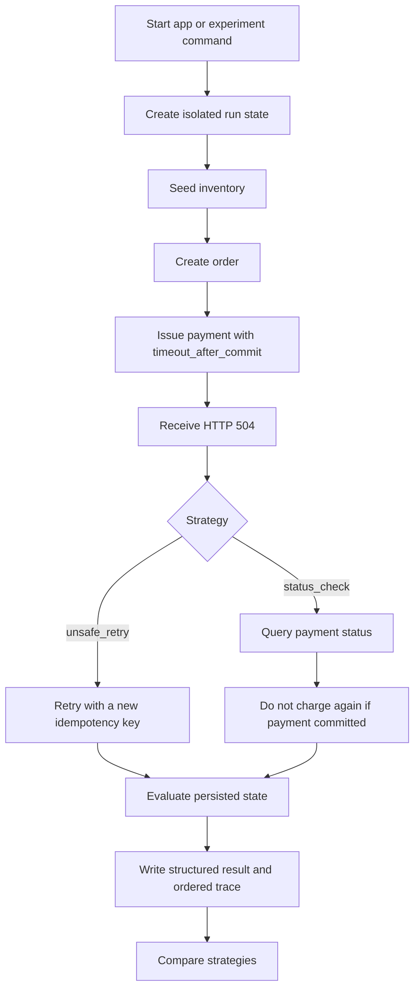

# AgentCrash — Application Flow and State Machine

**Status:** MVP workflow specification  
**Last updated:** 2026-10-25

## 1. Current interaction model
The MVP is a local developer tool, not a customer-facing store. The current interaction surface is the FastAPI HTTP API plus tests. The next vertical slice adds a CLI experiment runner. A visual dashboard is deferred.

## 2. Main workflow


## 3. State machines
### Order lifecycle
The order starts in the implementation's initial state and may transition to `PAID`. Exact enum/string values must match the current code. `PAID` does not prove validity: multiple successful charges can still violate invariants.

### Payment lifecycle
A payment may have an intermediate state if implemented. Once committed, it is successful in persisted state. The HTTP response may still time out even though the stored payment status is successful.

### Experiment lifecycle
1. `INITIALIZING`: allocate isolated state and scenario identifiers.
2. `READY`: inventory and order exist.
3. `FAULT_TRIGGERED`: payment commits and response returns HTTP 504.
4. `RECOVERING`: strategy queries status or retries.
5. `EVALUATING`: evaluator inspects persisted state.
6. `COMPLETED`: result and trace are produced.
7. `ERROR`: setup/execution failed; do not mislabel it as a normal agent failure.

## 4. Strategy transitions
### Unsafe retry baseline
- Receive 504.
- Do not query status.
- Retry using a different idempotency key.
- Record actions and responses.
- Evaluate persisted state.
- Expected: two successful charges for one order; violation `multiple_successful_charges_for_order`.

### Safe status-check baseline
- Receive 504.
- Query payment status using a supported order/payment reference.
- If persisted status shows success, do not submit another charge.
- Evaluate persisted state.
- Expected: one successful charge and no duplicate-charge violation.

Expected outcomes are assertions for tests, not hardcoded run results.

## 5. API routes
Use actual paths and payloads in `api.py` and `/docs`; do not invent endpoint names. The API should expose capabilities equivalent to:
- set inventory/stock;
- create order;
- attempt payment;
- query payment status;
- evaluate persisted state, if currently exposed via HTTP.

Local API docs: `http://127.0.0.1:8000/docs`.

Proposed future CLI command (not runnable until implemented):
```powershell
.\venv\Scripts\python.exe -m agentcrash.experiments.compare_payment_recovery
```

## 6. Error, empty, and exceptional states
- Invalid body: clear validation error; no mutation.
- Unknown item or insufficient stock: clear business error; no invalid order.
- Unknown order/payment: not-found response.
- Same key, conflicting intent: conflict response.
- Same key, same intent: return original payment.
- Timeout after commit: HTTP 504 while payment remains committed.
- Different key creates another successful charge: intentionally allowed in this test scenario; evaluator flags it.
- Invariant violation: return stable code and diagnostic; do not repair state silently.
- Unexpected internal exception: record sanitized diagnostic and classify as execution error.
- No trace events: incomplete experiment, not pass.
- Setup/database failure: abort and report setup failure.

## 7. Future dashboard screens (not implemented)
1. Experiment list: run, strategy, outcome, violations.
2. Run detail: scenario, final state, evaluator findings.
3. Trace viewer: ordered actions and responses.
4. Scenario detail: fault configuration and reproducibility inputs.

## 8. Flow acceptance criteria
- Strategies start from equivalent but isolated state.
- Trace shows fault before recovery action.
- Safe strategy checks status before deciding not to retry.
- Unsafe strategy retries with a different key.
- Evaluator reads persisted state after recovery.
- Setup errors are not misreported as agent failures.
