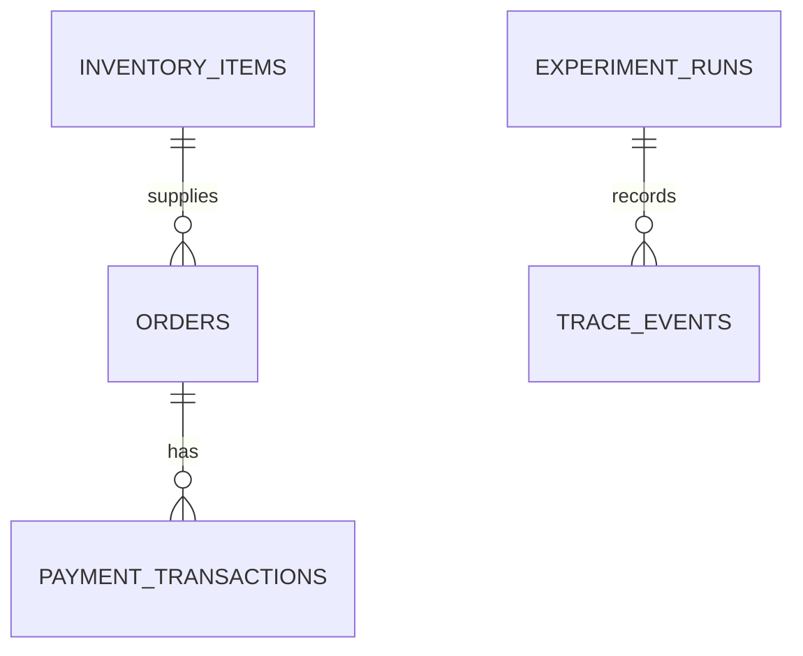

# AgentCrash — Database Schema Specification

**Status:** Logical schema draft; reconcile with `models.py` before applying changes  
**Last updated:** 2026-10-25

## 1. Scope
The MVP uses local SQLite and SQLAlchemy. This document specifies the intended logical schema; it does not claim every listed column already exists. Inspect actual models and database schema before changes. Use migrations if an existing persistent database must be upgraded.

RLS and authentication are **not applicable to the local single-user SQLite MVP**. SQLite does not provide PostgreSQL-style RLS. A hosted multi-user service would require a separate tenant/auth design.

## 2. Logical entities

### `inventory_items`
Stores stock for an item.

| Column | Logical type | Constraints/purpose |
|---|---|---|
| `id` | integer | Primary key |
| `sku` | string | Unique non-empty identifier, if supported |
| `name` | string | Display name, if supported |
| `stock_quantity` | integer | Non-negative |
| `unit_price_minor` | integer | Non-negative price in minor currency units, if stored here |
| `created_at` | datetime | Optional creation timestamp |

Current reported behavior sets an absolute stock level; replenishment events are not modeled. Confirm actual names and price representation.

### `orders`
Stores the intended purchase.

| Column | Logical type | Constraints/purpose |
|---|---|---|
| `id` | existing PK type | Primary key; retain current type |
| `item_id` | same type as inventory PK | FK to `inventory_items.id` |
| `quantity` | integer | Greater than zero |
| `unit_price_minor` | integer | Price snapshot, if modeled |
| `total_amount_minor` | integer | Should equal quantity × unit price snapshot |
| `status` | string/enum | Current lifecycle state |
| `created_at` | datetime | Optional timestamp |

Preserve the intended price at order creation if the design stores a price snapshot. If current code uses Decimal or another representation, document it and avoid floating-point money calculations.

### `payment_transactions`
Stores simulated payment attempts/charges.

| Column | Logical type | Constraints/purpose |
|---|---|---|
| `id` | existing PK type | Primary key |
| `order_id` | same type as order PK | FK to `orders.id` |
| `idempotency_key` | string | Unique constraint |
| `amount_minor` | integer | Non-negative amount |
| `status` | string/enum | Successful/failed state matching implementation |
| `created_at` | datetime | Optional timestamp |

Integrity rules:
- `idempotency_key` has a unique constraint.
- `order_id` references an existing order.
- Same-key retry for the same intent returns the existing transaction.
- Reusing a key for a conflicting intent returns a conflict.
- Multiple successful transactions may exist for one order in this simulator so unsafe retry is representable.
- The evaluator, not a one-charge-per-order database constraint, detects the duplicate-charge invariant.

### Future `experiment_runs` (not required yet)
| Column | Logical type | Purpose |
|---|---|---|
| `id` | UUID/string | Primary key |
| `scenario_id` | string | Scenario |
| `strategy_name` | string | Strategy |
| `status` | string | completed/incomplete/error |
| `started_at` | datetime | Start |
| `finished_at` | nullable datetime | End |
| `result_json` | nullable JSON/text | Result snapshot |

### Future `trace_events` (not required yet)
| Column | Logical type | Purpose |
|---|---|---|
| `id` | integer/UUID | Primary key |
| `run_id` | UUID/string | FK to experiment run |
| `sequence_number` | integer | Strictly increasing per run |
| `event_type` | string | request/response/decision/evaluation |
| `event_json` | JSON/text | Sanitized event |
| `created_at` | datetime | Timestamp |

For the first runner, a JSON trace file may be simpler than persistent trace tables.

## 3. Relationships

`EXPERIMENT_RUNS` and `TRACE_EVENTS` are future entities only.

## 4. Indexes and constraints
Recommended:
- Primary key on every table.
- FK `orders.item_id` → `inventory_items.id`.
- FK `payment_transactions.order_id` → `orders.id`.
- Unique index on `payment_transactions.idempotency_key`.
- Index on `payment_transactions.order_id`.
- Index on `orders.item_id` if useful.
- Check `quantity > 0`; stock and amounts non-negative.
- Future unique `(run_id, sequence_number)` for trace events.

Confirm existing constraints before adding them. Do not add a unique constraint on `payment_transactions.order_id`, because it would block the duplicate-charge scenario.

## 5. Money and IDs
Prefer integer minor currency units or `Decimal`; do not use binary floating point for money. Retain existing primary-key types unless a deliberate migration is approved. Use stable IDs in traces.

## 6. Authentication and RLS
### MVP
- Local developer-only tool.
- No user accounts/authentication.
- No RLS.
- Do not expose the local API publicly.

### Future hosted service — not implemented
Before multi-user hosting:
1. Select PostgreSQL or another database with suitable tenant isolation.
2. Add users, organizations/workspaces, and ownership IDs.
3. Authenticate requests with a vetted identity/session design.
4. Authorize every run, scenario, and trace server-side.
5. Enforce tenant isolation in all queries; consider PostgreSQL RLS as defense in depth.
6. Test cross-tenant read/write denial.
7. Never trust a client-supplied tenant ID without checking the authenticated principal.

Do not add placeholder RLS or homemade auth to the local MVP.

## 7. Verification checklist
- [ ] Compare this logical schema with actual SQLAlchemy models.
- [ ] Verify SQLite FK enforcement.
- [ ] Verify unique idempotency constraint.
- [ ] Verify evaluator queries all successful charges for an order.
- [ ] Add migrations before modifying existing persistent databases.
- [ ] Test setup against a fresh isolated database.
- [ ] Ensure tests cannot delete/corrupt the default development DB.
